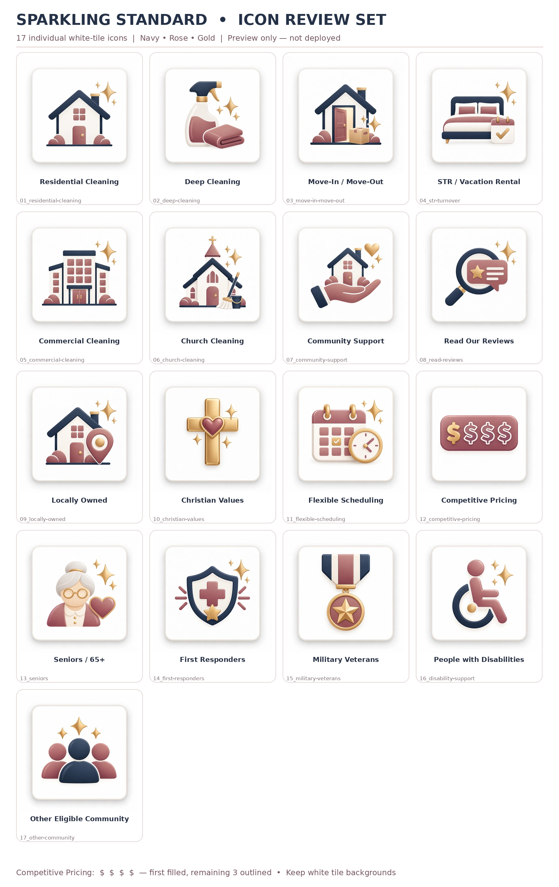
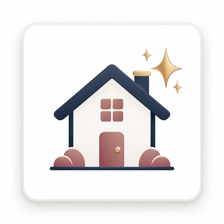
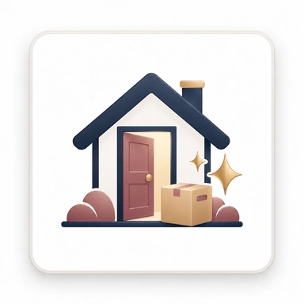
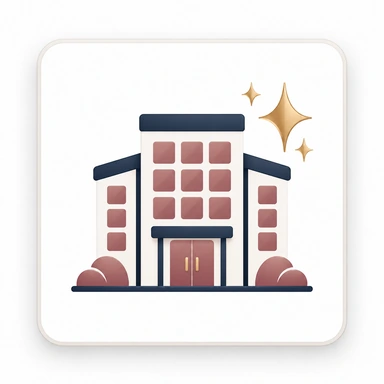
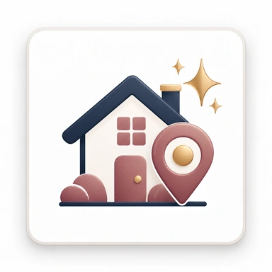
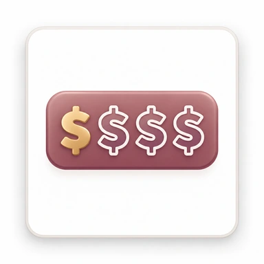

# White-tile icon inventory — 17 approved assets

Owner-supplied review pack: `Sparkling_Standard_White_Tile_Icons_17.zip`
(2026-10-25). The 17 white-tile raster designs are used verbatim. The full PNG
masters remain in the local master asset archive; the repository carries the
optimized 384 px WebP renditions in
`src/assets/icons/white-tile/`.

**Provenance:** the owner supplied the pack as the approved visual direction.
Competitive Pricing keeps **four dollar signs — first filled gold, three
outlined**; do not substitute a tag, coins or a calculator. The white tile,
rounded border and soft shadow are part of the artwork; never recolour, crop or
stretch a tile.

## Placement map

| # | Asset | Website placement | Rendered size | Component |
| --- | --- | --- | ---: | --- |
| 01 | Residential Cleaning | Homepage service card; service page; estimate hub | 80 px | `PremiumIcon`, `HomeServiceCard`, `ServiceCard`, `EstimateHub` |
| 02 | Deep Cleaning | Homepage service card; service page | 80 px | same |
| 03 | Move-In / Move-Out | Homepage service card; service page | 80 px | same |
| 04 | STR / Vacation Rental | Homepage service card; service page; estimate hub | 80 px | same |
| 05 | Commercial Cleaning | Homepage service card; service page; estimate hub | 80 px | same |
| 06 | Church Cleaning | Homepage service card; service page; estimate hub | 80 px | same |
| 07 | Community Support | Homepage Community Support spotlight | 80 px | `src/pages/index.astro` |
| 08 | Read Our Reviews | Reviews section heading | 72 px | `src/components/Reviews.astro` |
| 09 | Locally Owned | Trust banner | 64 px | `src/components/TrustChips.astro` |
| 10 | Christian Values | Trust banner | 64 px | `TrustChips` |
| 11 | Flexible Scheduling | Trust banner | 64 px | `TrustChips` |
| 12 | Competitive Pricing | Trust banner — exact four-dollar design | 67 px | `TrustChips` |
| 13 | Seniors / 65+ | Community spotlight list; Supportive Home eligibility | 56 / 72 px | homepage + `supportive-home-cleaning.astro` |
| 14 | First Responders | Community spotlight list; Supportive Home eligibility | 56 / 72 px | same |
| 15 | Military Veterans | Community spotlight list; Supportive Home eligibility | 56 / 72 px | same |
| 16 | People with Disabilities | Community spotlight list; Supportive Home eligibility | 56 / 72 px | same |
| 17 | Other Eligible Community | Community spotlight list; Supportive Home eligibility | 56 / 72 px | same |

The small “Read Our Reviews” footer button intentionally keeps the simple vector
magnifying glass, as specified in the owner pack’s implementation guide: a
384 px raster tile is not appropriate inside a small text button.

## Thumbnails

| | | |
| --- | --- | --- |
|  |  |  |
|  |  |  |
|  |  |  |
|  |  |  |
|  |  |  |
|  |  | |

## Implementation rules

- `PremiumIcon.astro` is the only renderer; `src/lib/premium-icons.ts` is the
  only name registry.
- Adjacent text names every concept, so tiles are decorative (`alt=""` and
  `aria-hidden="true"`). Pass a `label` only when an icon stands alone.
- Images have intrinsic width/height and lazy/async loading to prevent layout
  shift. Astro generates responsive WebP output; source tiles are not downloaded
  twice by hand.
- Review actual desktop and mobile rendering after any placement change.
- Original 1254 px PNGs remain in the local master folder for future print or
  large-format use. They are not committed to the public repository.
